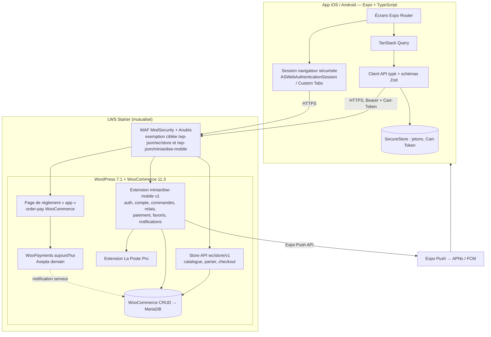
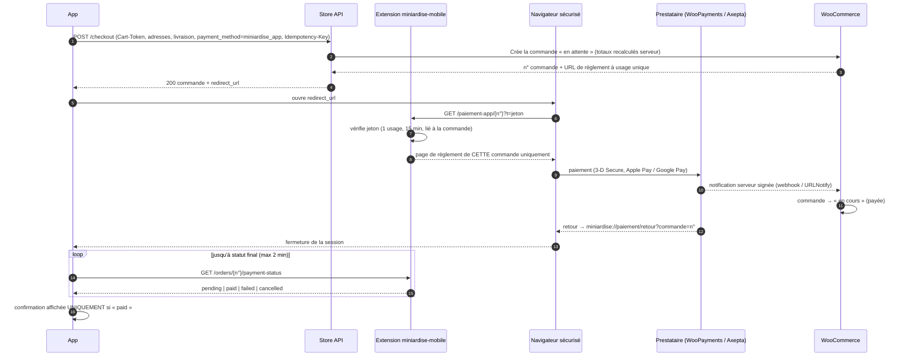

# MiniarDise Mobile — Dossier d'architecture (Phase 2)

**Date :** 24/11/2026 · **Statut :** proposition à valider · **Prérequis :** rapport d'audit `01_RAPPORT_AUDIT_PHASE1.md`

---

## 1. Décisions actées (réponses d'Alexandre du 24/11/2026)

| # | Sujet | Décision | Conséquence pour l'architecture |
|---|---|---|---|
| D1 | Paiement | **WooPayments maintenant**, comme sur le site. **Axepta deviendra le moyen principal** une fois réparé. | Un circuit de paiement **indépendant du prestataire** : changer de prestataire = un réglage WooCommerce, sans nouvelle version de l'app. |
| D2 | Points relais | **Dès la V1.** | Intégration de la sélection de point relais La Poste Pro (Colissimo et Chronopost) dans l'app. |
| D3 | Comptes Apple / Google | Pas encore. On développe et on **prépare tout pour la publication**. | Builds simulateur iOS et APK Android sans compte développeur ; identifiants, icônes, confidentialité et profils EAS prêts. |
| D4 | Hébergement | LWS **Starter**, mutualisé (à confirmer dans le panel). | Pas de service permanent côté serveur ; tâches planifiées légères ; exemption anti-robots à obtenir de LWS. |

### Constat livraison (précision de l'audit)

Les livraisons réellement utilisées sur 12 mois sont **toutes gérées par l'extension La Poste Pro Expéditions**, plus le retrait :

| Méthode | Commandes (12 mois) |
|---|---|
| Point relais Chronopost (2 à 4 jours) | 150 |
| Point relais Colissimo (24 à 48 h) | 114 |
| Retrait à Cormeilles-en-Parisis | 88 |
| Colissimo à domicile (24 à 48 h) | 79 |
| Chronopost Europe (relais / domicile) | 4 |

Les méthodes Mondial Relay et UPS restent configurées dans WooCommerce mais leurs extensions ne sont plus installées : elles ne sont pas proposées aux clients. **La V1 couvre donc 100 % des livraisons réellement utilisées.** Point favorable : l'extension La Poste Pro enregistre déjà le point relais choisi sur les commandes passées par la Store API (crochet `woocommerce_store_api_checkout_order_processed`).

---

## 2. Vue d'ensemble



### Responsabilités

| Composant | Responsable de | N'a jamais le droit de |
|---|---|---|
| App mobile | Affichage, saisie, cache court, stockage sécurisé des jetons | Calculer un prix, un total ou un statut de paiement ; détenir une clé ou un secret serveur |
| Store API | Catalogue, panier, frais de port, coupons, taxes, création de commande | — (fournie par WooCommerce, non modifiée) |
| Extension `miniardise-mobile` | Authentification, compte, historique, points relais, préparation du paiement, statut, favoris, notifications, journal de sécurité | Modifier le cœur WooCommerce, le thème ou une autre extension ; écrire en SQL direct dans les tables de commandes |
| Page de règlement app | Afficher la page de paiement WooCommerce de **une** commande précise | Ouvrir une session WordPress, donner accès au compte client |
| Prestataire de paiement | Saisie carte, 3-D Secure, Apple Pay / Google Pay, notification serveur | — |
| WooCommerce | Source de vérité unique | — |

---

## 3. Choix structurants (ADR)

### ADR-01 — API : Store API + extension sur mesure

- **Retenu :** Store API pour catalogue / panier / commande ; extension `miniardise-mobile` (namespace `miniardise-mobile/v1`) pour le reste.
- **Écarté :** WC REST API `wc/v3` depuis l'app (clés administrateur dans l'app = faille critique) ; CoCart (extension tierce supplémentaire sans gain décisif) ; serveur intermédiaire séparé (coût et maintenance, gardé en plan B si LWS refuse l'exemption — voir §9).

### ADR-02 — Authentification : jetons opaques révocables

- Connexion par e-mail + mot de passe vérifiés par WordPress (`wp_authenticate`), donc mêmes comptes que le site.
- **Jeton d'accès** aléatoire (256 bits) valable 15 min ; **jeton de rafraîchissement** valable 30 jours, **rotatif** (un nouveau à chaque usage) ; la réutilisation d'un ancien jeton révoque toute la famille (vol détecté).
- Stockés **hachés** (SHA-256) dans une table dédiée ; jamais en clair côté serveur.
- Côté app : SecureStore (Keychain iOS / Keystore Android), jamais AsyncStorage.
- L'extension branche ces jetons sur `determine_current_user` **uniquement** pour les requêtes HTTPS vers `wc/store/*` et `miniardise-mobile/*` : la Store API reconnaît alors le client (adresses pré-remplies, panier rattaché au compte). Aucun cookie → pas de CSRF.
- Révocation : déconnexion, « déconnecter tous mes appareils », changement ou réinitialisation de mot de passe (crochets `password_reset` / `profile_update`), suppression de compte.
- **Écarté :** extension JWT déjà installée (pas de révocation ni rafraîchissement, aucune clé configurée) ; mots de passe d'application WordPress (non prévus pour des clients finaux) ; OAuth complet (surdimensionné pour un seul client mobile).
- Prérequis serveur : l'en-tête `Authorization` est déjà transmis à PHP par le `.htaccess` actuel (`E=HTTP_AUTHORIZATION`).

### ADR-03 — Paiement : page de règlement indépendante du prestataire

Problème : WooPayments n'a pas de page de paiement hébergée utilisable par une app ; Axepta en a une. Faire deux intégrations natives obligerait à refaire l'app au passage à Axepta.

**Solution retenue :** l'app ne paie jamais elle-même. Elle crée une commande « en attente de paiement », puis ouvre la **page de règlement WooCommerce** de cette commande dans une session navigateur sécurisée. Cette page affiche les moyens de paiement actifs sur le site (WooPayments aujourd'hui avec carte, Apple Pay et Google Pay ; Axepta demain). Le passage à Axepta se fait dans les réglages WooCommerce, **sans nouvelle version de l'app**.



Détails :
- **Passerelle technique « Paiement dans l'app »** (`miniardise_app`) : invisible sur le site, disponible uniquement pour les requêtes authentifiées de l'app. Elle ne débite rien : elle laisse la commande en attente et renvoie l'URL de règlement. Elle permet d'utiliser la Store API standard (et donc l'enregistrement automatique du point relais par La Poste Pro).
- **URL de règlement à usage unique** : jeton aléatoire haché, valable 15 min, lié à une commande et à un client ; il donne le droit de **payer cette commande** (capacité `pay_for_order` limitée), pas d'ouvrir une session.
- **Vérité du paiement** : uniquement le statut WooCommerce mis à jour par la notification serveur du prestataire. Le retour navigateur ne prouve rien.
- **Abandon / échec / annulation** : commande laissée « en attente » puis annulée automatiquement par WooCommerce (réglage existant : réservation de stock 60 min) ; l'app propose « Reprendre le paiement » tant que la commande est en attente.
- **Doublons** : en-tête `Idempotency-Key` (UUID généré par l'app à l'ouverture du récapitulatif) ; même clé = même commande renvoyée, jamais une seconde.
- **Apple Pay** : fonctionne dans la session navigateur sécurisée ; le domaine est déjà vérifié pour le site (`/.well-known` conservé).
- **À prouver en Phase 3 (PoC)** : WooPayments + Apple Pay / Google Pay dans la session navigateur sur iPhone et Android réels, et la redirection de retour.

**Écarté :** SDK Stripe natif avec WooPayments (non documenté pour des tiers, couplage fort, à refaire pour Axepta) ; WebView intégrée (Apple Pay et 3-D Secure moins fiables, moins de confiance utilisateur) ; app « vue web » du site (refus Apple).

### ADR-04 — Points relais La Poste Pro

- **Liste des points** : `GET /miniardise-mobile/v1/parcel-points?rate_id=…&postcode=…&country=…` → l'extension appelle les fonctions de l'extension La Poste Pro (réseaux actifs Colissimo / Chronopost), normalise et met en cache 15 min par code postal.
- **Choix du point** : via le mécanisme officiel d'extension du panier de la Store API (`POST /wc/store/v1/cart/extensions`, namespace `miniardise-mobile`), qui s'exécute dans la session du panier ; l'extension enregistre le point exactement comme le fait le site.
- **Enregistrement sur la commande** : fait par La Poste Pro elle-même au passage de commande Store API. Contrôle serveur : commande refusée si une méthode relais est choisie sans point valide.
- **Affichage app** : liste triée par distance + carte (react-native-maps, sans clé pour Apple Plans ; clé Google Maps Android à prévoir) — la carte peut passer en V1.1 si nécessaire, la liste suffit à commander.
- **Risque** : dépendance aux fonctions internes de La Poste Pro (pas une API publique). Mitigation : adaptateur isolé + test d'intégration qui casse au premier changement de version de l'extension.

### ADR-05 — Stack mobile

| Brique | Choix | Justification |
|---|---|---|
| Socle | Expo, **dernier SDK stable au démarrage** (SDK 58 publié à ce jour), nouvelle architecture RN | Un seul code iOS/Android, builds et publication EAS |
| Langage | TypeScript strict | Sûreté du contrat d'API |
| Navigation | Expo Router, 4 onglets : Accueil, Boutique, Panier, Compte | Conventions natives |
| Données serveur | TanStack Query | Cache, annulation, nouvelles tentatives maîtrisées |
| État local | Zustand (seulement préférences, session UI) | Le panier vit côté serveur |
| Formulaires | React Hook Form + Zod | Validation partagée avec le contrat d'API |
| Stockage sensible | expo-secure-store | Keychain / Keystore |
| Paiement | expo-web-browser (`openAuthSessionAsync`) | Session navigateur sécurisée |
| Notifications | expo-notifications + Expo Push | Gratuit, pas de serveur à maintenir |
| Images | expo-image | Cache disque, redimensionnement |
| Cartes relais | react-native-maps (si carte en V1) | Natif |
| Tests | Jest + React Native Testing Library ; Maestro (E2E) | Standard, Maestro simple à maintenir |
| Suivi d'erreurs | EAS Observe ou Sentry (sans données personnelles) | À trancher en Phase 3 |

Rien d'autre sans justification écrite. Pas d'UI web (Tailwind web, Radix) : le design system est construit en natif à partir des tokens MiniarDise Or.

### ADR-06 — Préparation des stores sans compte développeur (D3)

| Possible dès maintenant | Nécessite les comptes |
|---|---|
| Identifiants d'app : iOS `fr.epiceriefineminiardise.app`, Android `fr.epiceriefineminiardise.app` (+ variantes `.dev` / `.preview` pour installer les 3 côte à côte) | Signature iOS pour iPhone réel, TestFlight, App Store |
| Nom, icône, écran de démarrage, versions, permissions, manifeste de confidentialité iOS | Universal links iOS (nécessite l'identifiant d'équipe Apple) |
| `eas.json` : profils `development`, `preview`, `production` | Soumission Google Play (et période de test fermé imposée aux nouveaux comptes) |
| Builds **simulateur iOS** et **APK Android** pour tester | Notifications push iOS réelles (clé APNs) |
| Textes des fiches magasin, captures, questionnaires confidentialité (brouillons) | — |

Recommandation : créer **dès que possible** le compte Apple Developer *organisation* (numéro D-U-N-S, délai de plusieurs jours à semaines) et le compte Google Play *organisation*, pour ne pas retarder la publication.

### ADR-07 — Notifications

- L'app enregistre son jeton Expo Push (avec consentement) → `POST /miniardise-mobile/v1/push-tokens`.
- L'extension écoute les changements de statut de commande (`woocommerce_order_status_changed`) et met les messages **en file** (table dédiée).
- Envoi par lot à Expo Push via une tâche planifiée : **cron LWS** sur `wp-cron.php` si disponible sur Starter (à confirmer), sinon WP-Cron déclenché par les visites (délai de quelques minutes acceptable pour des notifications transactionnelles).
- V1 : commande confirmée, paiement confirmé, expédiée. Marketing : V2, consentement séparé.

### ADR-08 — Hébergement mutualisé (D4)

Ce que l'architecture évite volontairement sur un mutualisé : pas de processus permanent, pas de WebSocket, pas de file de messages externe, pas de traitement lourd par requête. Ce qu'elle ajoute : cache serveur des listes de points relais, pagination stricte, réponses légères, exclusion des routes API du cache de pages (WP Fastest Cache / LWS), limitation de débit stockée en base (pas de Redis).

---

## 4. Contrat d'API V1 (extension `miniardise-mobile/v1`)

Le contrat complet (OpenAPI + schémas Zod partagés) sera écrit en Phase 3 dans `packages/api-contract`. Liste des routes :

| Méthode | Route | Auth | Rôle |
|---|---|---|---|
| GET | `/config` | non | Version minimale d'app, messages, moyens de livraison actifs, liens CGV / confidentialité |
| GET | `/home` | non | Bannière, nouveautés, sélections (contenu géré dans WordPress) |
| GET | `/products/{id}/details` | non | Fiche enrichie du thème : allergènes, valeurs nutritionnelles, conservation, recettes |
| POST | `/auth/register` | non | Création de compte (limitée en débit, réponse neutre) |
| POST | `/auth/login` | non | Connexion → jetons |
| POST | `/auth/refresh` | refresh | Rotation des jetons |
| POST | `/auth/logout` | oui | Révoque l'appareil courant (`all=true` : tous) |
| POST | `/auth/password-reset` | non | Déclenche l'e-mail WordPress standard (réponse identique que le compte existe ou non) |
| GET / PATCH | `/me` | oui | Profil |
| GET / PUT | `/me/addresses` | oui | Adresses facturation / livraison |
| DELETE | `/me` | oui + mot de passe | Suppression du compte (données personnelles effacées, commandes anonymisées et conservées pour la comptabilité) |
| GET | `/me/orders` | oui | Historique paginé |
| GET | `/me/orders/{id}` | oui | Détail + suivi La Poste + point relais (404 si la commande n'est pas au client) |
| GET | `/orders/{id}/payment-status` | oui ou clé de commande | Statut de paiement pour l'écran d'attente |
| POST | `/orders/{id}/payment-link` | oui ou clé de commande | Nouvelle URL de règlement (reprise d'un paiement abandonné) |
| GET | `/parcel-points` | non (limité) | Points relais La Poste Pro |
| POST / DELETE | `/push-tokens` | oui | Enregistrer / retirer un appareil |
| — | `/cart/extensions` (Store API, namespace `miniardise-mobile`) | session panier | Choix du point relais |

Utilisées telles quelles depuis la Store API : `products`, `products/categories`, `cart`, `cart/add-item`, `cart/update-item`, `cart/remove-item`, `cart/apply-coupon`, `cart/remove-coupon`, `cart/update-customer`, `cart/select-shipping-rate`, `checkout`.

Conventions : JSON, erreurs `{ code, message }` sans détail technique, `X-App-Version` obligatoire, pagination par `page` / `per_page` (max 50), dates ISO 8601, montants en centimes (comme la Store API).

### Données ajoutées par l'extension

| Table (préfixe `wp8dc_mm_`) | Contenu |
|---|---|
| `tokens` | jetons hachés, famille, appareil, expiration, révocation |
| `pay_links` | jetons de règlement hachés, commande, expiration, utilisé |
| `idempotency` | clé, client, commande, date (purge à 24 h) |
| `push_tokens` / `push_queue` | appareils, consentement, messages en attente |
| `rate_limits` | compteurs par IP / compte / route |
| `security_log` | événements (connexion échouée, jeton réutilisé, accès refusé) sans mot de passe ni jeton |

Favoris (V2) : métadonnée utilisateur. Création des tables à l'activation, suppression propre à la désinstallation, migrations versionnées.

---

## 5. Application mobile

```
apps/mobile/
├── src/app/                   # Expo Router (routes uniquement)
│   ├── (tabs)/index.tsx       # Accueil
│   ├── (tabs)/boutique/…      # catégories, liste, recherche
│   ├── (tabs)/panier.tsx
│   ├── (tabs)/compte/…        # connexion, profil, adresses, commandes
│   ├── produit/[id].tsx
│   ├── commande/…             # adresses → livraison/relais → récap → paiement → résultat
│   └── _layout.tsx
├── src/   (hors routes)
│   ├── api/                   # client HTTP, intercepteurs (jetons, Cart-Token, version), erreurs
│   ├── features/              # catalog, cart, checkout, account, orders, notifications
│   ├── components/            # design system MiniarDise Or
│   ├── theme/                 # tokens (couleurs, typo, espacements)
│   └── lib/                   # stockage sécurisé, formatage prix, logs
└── tests/
```

Règles de cache (TanStack Query) :

| Donnée | Durée de fraîcheur | Remarque |
|---|---|---|
| Catégories, accueil | 30 min | Affichage du cache hors connexion, signalé |
| Liste / fiche produit | 5 min | Prix et stock **revalidés par le panier** avant paiement |
| Panier | 0 | Toujours la réponse serveur |
| Statut de commande / paiement | 0 | Jamais déduit côté app |
| Points relais | 15 min | Par code postal |

Nouvelles tentatives : uniquement sur GET et erreurs réseau / 5xx, 3 essais avec délai croissant ; jamais sur `checkout` (protégé par l'Idempotency-Key, que l'app renvoie à l'identique si l'utilisateur relance).

---

## 6. Sécurité — correspondance OWASP API Security Top 10 (2023)

| Risque | Mesure |
|---|---|
| API1 Accès aux objets d'un autre client | Chaque route « me » et commande filtre par client côté serveur ; tests automatisés d'accès croisé |
| API2 Authentification défaillante | Jetons opaques hachés, rotation, détection de réutilisation, limitation des tentatives, messages neutres |
| API3 Propriétés exposées / modifiables | Réponses construites champ par champ (liste blanche) ; `PATCH /me` limité aux champs autorisés |
| API4 Consommation de ressources | Limitation de débit par route, pagination plafonnée, cache relais |
| API5 Fonctions non autorisées | Aucune route d'administration dans l'extension |
| API6 Abus de flux métier | Idempotency-Key, limitation création de compte / reset / relais |
| API7 SSRF | Aucun appel sortant paramétré par l'app (relais : réseaux et adresse validés) |
| API8 Mauvaise configuration | HTTPS uniquement, routes API exclues du cache, erreurs sans détail, extensions à risque désactivées |
| API9 Inventaire | Contrat OpenAPI versionné, `/config` impose une version minimale d'app |
| API10 Consommation d'API tierces | Réponses La Poste Pro et Expo Push validées et bornées |

Côté app (MASVS) : SecureStore, pas de secret embarqué, journalisation sans données personnelles, captures d'écran autorisées (pas de donnée bancaire dans l'app), détection de version obsolète.

Prérequis sur le site **avant** la mise en ligne de l'API (à faire d'abord en recette) : désactiver `wp-cli-login-server`, `mobile-assistant-connector`, `jwt-authentication-for-wp-rest-api`, `woocommerce-legacy-rest-api` (après vérification qu'aucun service n'en dépend) ; mettre à jour `woocommerce-pdf-invoices-packing-slips` ; PHP 8.3 ; double authentification des administrateurs.

---

## 7. Environnements

| | Développement | Recette | Production |
|---|---|---|---|
| WordPress | Local (wp-env / Docker) sur ton Mac, base **anonymisée** | `recette.epiceriefineminiardise.fr` | `epiceriefineminiardise.fr` |
| Paiement | Mode test WooPayments | Mode test WooPayments (puis Axepta test) | Réel |
| App | `fr.epiceriefineminiardise.app.dev` | `….preview` | `fr.epiceriefineminiardise.app` |
| Données | Fictives / anonymisées | Anonymisées | Réelles |

L'URL d'API est fixée par profil de build EAS ; une app de production ne peut pas pointer vers la recette, et inversement.

---

## 8. Plan de tests

| Niveau | Outil | Cible |
|---|---|---|
| Unitaires app | Jest + RNTL | formatage prix, schémas, logique panier / tunnel |
| Unitaires extension | PHPUnit (wp-env) | jetons, rotation, droits, idempotence, adaptateur La Poste |
| API / intégration | PHPUnit + scénarios HTTP contre la recette | les 20 scénarios du prompt + accès croisé + énumération |
| Bout en bout | Maestro sur simulateur iOS et émulateur Android | inscription → achat relais → paiement test → historique |
| Sécurité | Skill OWASP + `npm audit` / `composer audit` | extension et dépendances |
| Non-régression site | Suites existantes (`3_TESTS`) + passage manuel tunnel web | le site ne doit pas changer de comportement |

Les paiements ne sont testés qu'en mode test du prestataire.

---

## 9. Risques et preuves de faisabilité (début de Phase 3)

| # | Risque | Preuve à obtenir | Plan B |
|---|---|---|---|
| R1 | LWS refuse ou ne sait pas exempter les routes API d'Anubis | Réponse au ticket (texte prêt : `03_TICKET_LWS.md`) + appel réussi depuis une app de test | Liste blanche d'IP pour un petit relais d'API hébergé ailleurs, ou changement d'offre LWS |
| R2 | ModSecurity rejette des requêtes JSON | Test des 15 routes sur la recette | Règles d'exception demandées à LWS |
| R3 | Store API ne reconnaît pas l'utilisateur via le jeton | PoC `determine_current_user` | Panier invité + rattachement au compte à la commande |
| R4 | WooPayments / Apple Pay dans la session navigateur | PoC sur iPhone et Android réels (nécessite au minimum un build de développement installable) | Carte seule en V1, Apple Pay / Google Pay en V1.1 |
| R5 | Fonctions internes La Poste Pro modifiées par une mise à jour | Test d'intégration qui échoue immédiatement | Appel direct de l'API La Poste Pro avec la clé du site, côté serveur |
| R6 | Cron indisponible sur Starter | Vérification panel | WP-Cron classique |

---

## 10. Phase 3 — Fondations (prochaine étape, après ta validation)

1. Dépôt GitHub privé `miniardise-mobile` (monorepo) — nécessite de relier GitHub à Claude.
2. Ticket LWS envoyé (par toi).
3. WordPress local avec base anonymisée générée depuis le dump (script, rien de nominatif ne sort de ton Mac).
4. Extension `miniardise-mobile` : squelette, tables, `/config`, authentification, tests PHPUnit.
5. App Expo : squelette, design system MiniarDise Or, 4 onglets, catalogue branché sur la recette.
6. PoC R1 à R4.
7. CI : lint, types, tests.

**Critère de sortie :** l'app de développement affiche le catalogue de la recette sur simulateur iOS et émulateur Android, la connexion fonctionne avec révocation testée, la CI est verte, les PoC R1–R4 sont concluants ou leur plan B est acté.
